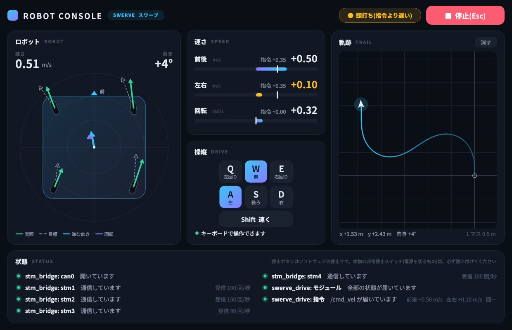

# swerve_drive — 独立ステアリング(スワーブ)の足回り

4 つの独立ステアリングのモジュールで、全方向に動く足回りを動かす ROS 2 パッケージです。
ロボット全体の目標速度 `/cmd_vel` を、各モジュールの「向き」と「タイヤの速さ」に変えて STM32 に送り、
STM32 から返ってくる実際の向きと速さから、ロボットがどれだけ動いたか(オドメトリ)を計算します。

## 全体の流れ

```
 ゲームパッド ─ joy ─ teleop_twist_joy ─┐
 キーボード(WASD)─ robot_console ───────┼─▶ /cmd_vel ─▶ swerve_node ─▶ stm1〜4/command ─▶ stm_bridge ─▶ STM32 × 4
 Nav2(自動操縦、これから)────────────┘    (vx, vy, ω)      │          [向き, タイヤの速さ]   (CAN / USB シリアル)
                                                            │
                         /odom、TF(odom → base_link) ◀─────┴─── stm1〜4/state ◀───────────────────────────┘
                         /swerve/markers(コンソールや rviz2 の矢印)   [今の向き, 今のタイヤの速さ]
```

- **操縦のしかたを変えても、`swerve_node` はそのまま**です。`/cmd_vel` を出すものを、ゲームパッド・キーボード・Nav2 のどれにするかだけです。
- **STM32 が向きをどう測るか(ロータリーエンコーダ、ステッピングモーターなど)を変えても、`swerve_node` はそのまま**です。STM32 が下の「約束」を守れば動きます。

## STM32 との約束(トピック)

モジュールごとに、`stm_bridge` を通して次の 2 つをやり取りします(ID は `config/swerve.yaml` の `device_ids`)。

| トピック | 向き | 中身 |
|---|---|---|
| `stm<ID>/command` | Pi → STM32 | `[目標の向き rad, 目標のタイヤの速さ rad/s]` |
| `stm<ID>/state` | STM32 → Pi | `[今の向き rad, 今のタイヤの速さ rad/s]`(10 ms ごと) |

- **向き**:0 がロボットの前、上から見て反時計回りが正、-π〜π。
- **タイヤの速さ**:タイヤの回転の速さ。正で「向き」の方向に進みます。
- 90° より大きく向きを変えるときは、`swerve_node` が向きを 180° 反転して、タイヤを逆回転させます。なので STM32 は、届いた向きにそのまま合わせれば OK です。
- 指令が 100 ms 以上届かなければ、STM32 はタイヤを止めます(今の CAN / USB シリアルの仕組みと同じ)。

## ファイル

| ファイル | 中身 |
|---|---|
| `swerve_drive/kinematics.py` | 計算の本体(逆運動学・順運動学・オドメトリ)。ROS なしで動くので、テストしやすい |
| `swerve_drive/swerve_node.py` | ROS 2 のノード。`/cmd_vel` を受け取って指令を出し、`/odom` と TF と矢印を出す |
| `swerve_drive/robot_console.py` | **ロボットコンソール**: WASD の操縦、速さ、軌跡、状態、停止ボタンを 1 つにまとめたウィンドウ(ROS とのやり取りとウィンドウ) |
| `swerve_drive/console_state.py` | コンソールに表示するデータ(ROS にも画面にも依存しない。テストあり) |
| `swerve_drive/console_theme.py` / `console_widgets.py` | コンソールの色・フォントと、各カードの絵(PyQt5) |
| `swerve_drive/teleop_keys.py` | 押しているキー → 速さの計算 |
| `swerve_drive/robot_status.py` | `/diagnostics` と停止ボタン(`/drive_stop`)の共通の部品 |
| `swerve_drive/firmware_modules.py` | 実機の代わりに、**STM32 のファームウェアをそのまま動かして**モジュールのふりをする(`firmware:=true`) |
| `swerve_drive/firmware_sim.py` | `firmware/sim/firmware_sim.c` とファームウェアの部品を gcc でビルドして呼ぶ |
| `swerve_drive/fake_modules.py` | 実機の代わりに、モジュールのふりをする(向きはゆっくり回り、タイヤは少し遅れて追いつく) |
| `config/swerve.yaml` | **ロボットに合わせて書き換える設定**(モジュールの位置、タイヤの半径、ID など) |
| `config/joy.yaml` | ゲームパッドのボタンとスティックの割り当て |
| `config/swerve.rviz` | rviz2 の表示設定(上から見た図) |
| `launch/swerve.launch.py` | ロボット側(足回り一式)を起動する。`sim:=true` で実機なしでも |
| `launch/teleop.launch.py` | PC 側(ロボットコンソール + ゲームパッド)を起動する |
| `test/test_kinematics.py` | 計算のテスト(`colcon test` で実行される) |

## 使い方

まず、dev コンテナでビルドします(`ros` でコンテナに入ってから)。

```bash
cd ~/ros2_ws
colcon build --symlink-install
source install/setup.bash
```

### 1. 実機なしで試す(PC)

ホストで `./sim.sh`(オムニなら `./sim.sh omni`)を実行すると、ビルドから下の起動までを 1 回でやります(コンテナの中なら `~/ros2_ws` で同じ `./sim.sh`)。1 つずつ起動するときは次のとおりです。

```bash
ros2 launch swerve_drive swerve.launch.py sim:=true console:=true
```

**ロボットコンソール**(`robot_console`)が開きます。操縦・速さ・状態・停止を 1 つにまとめたウィンドウです。



(上の画像は、表示の確認用のデータを入れたときのものです)

```
┌ ROBOT CONSOLE  [SWERVE] ─────────────── [● すべて OK] ─ [■ 停止(Esc)] ┐
│ ロボット               │ 速さ               │ 軌跡                     │
│  上から見た図          │  前後・左右・回転    │  走った道すじ(地図)      │
│  (画面の上が前)       │  指令と実際         │                          │
│                        ├────────────────────┤                          │
│                        │ 操縦                │                          │
│                        │  Q W E / A S D      │                          │
├────────────────────────┴────────────────────┴──────────────────────────┤
│ 状態  ● stm_bridge: stm1  通信しています  受信 100 回/秒  …             │
└──────────────────────────────────────────────────────────────────────┘
```

| カード | 中身 |
|---|---|
| **ロボット** | 上から見た図(画面の上がロボットの前)。各モジュールの**実際の向き(緑の矢印)**と**目標(白い点線)**、矢印の長さは速さ。中心の水色の矢印は実際に進んでいる向き、紫の弧は回転。左上に速さ、右上に向き |
| **速さ** | 前後・左右・回転ごとに、**実際の速さ(バーと大きな数字)**と**指令の速さ(白い印と小さな数字)**。実際が指令の 8 割に届かないと、オレンジ色(頭打ち)になる(`./sim.sh fw` だと STM32 の上限も反映される) |
| **操縦** | 下の表のキー。押しているキーが光る。画面のキーをマウスで押してもよい |
| **軌跡** | 走った道すじ(起動したときの前が画面の上)。「消す」で消せる |
| **状態** | `/diagnostics` の一覧(下の「ロボットの状態」) |
| **右上** | 全体の状態(すべて OK / 注意 / エラー ○ 件 / 停止中)と、**停止ボタン** |

**操縦**:このウィンドウを選んだまま、キーを押している間だけ動きます。

| キー | 動き |
|---|---|
| W / S | 前 / 後ろ |
| A / D | 左 / 右(向きを変えずに横に動く) |
| Q / E | 左回り / 右回り |
| Shift | 速くする(2 倍) |
| Esc / スペース | 停止(停止ボタンと同じ) |

W と D を同時に押すと斜めに進みます。ほかのウィンドウを選ぶと止まります。速さは `linear_speed` / `angular_speed` パラメータで変えられます。

ゲームパッドがあれば、`joy:=true` を付けると使えます(LB を押している間だけ動きます。ボタンの割り当ては `config/joy.yaml`)。rviz2 も見たいときは `rviz:=true` を付けます(`./sim.sh joy rviz`)。

```bash
ros2 launch swerve_drive swerve.launch.py sim:=true console:=true joy:=true rviz:=true
```

コンソールの画面は PyQt5 で描いています(dev イメージに入っている)。色やフォントを変えたいときは `console_theme.py` を見てください。

### ロボットの状態(`/diagnostics` と停止ボタン)

stm_bridge と足回りのノードは、自分の状態を **`/diagnostics`**(ROS 2 の共通の決まり)に 1 秒ごとに出しています。コンソールの「状態」のカードは、これを一覧で表示します。

| 項目 | OK | 注意 / エラー |
|---|---|---|
| `stm_bridge: can0`(通信の線) | 開いている | 開けない、送信できなかった指令がある |
| `stm_bridge: stm1`〜 | 状態が届いている(受信 回/秒) | 回数が少ない / 届いていない(配線・電源・ID) |
| `swerve_drive: 指令` | `/cmd_vel` が届いている、または指令なし | 停止ボタンで止めている |
| `swerve_drive: モジュール` | 全部の状態が届いている | どれかが届いていない |

- しばらく届かない項目は灰色で「届いていない」と出ます(そのノードが止まったか、Wi-Fi が切れた)。
- **停止ボタン**(または Esc / スペースキー)を押すと、足回りは `/cmd_vel` を無視して止まります。「▶ 再開」を押すまで止まったままです。コンソールをあとから開いても、足回りが止まっていれば「停止中」と出ます。
- **停止ボタンはソフトウェアの停止です。本物の非常停止スイッチ(モーターの電源を切るもの)は、必ず別に付けてください。**

同じ `/diagnostics` は、ROS 2 標準の **rqt_robot_monitor** でも見られます(`ros2 run rqt_robot_monitor rqt_robot_monitor`)。

### 1.5 STM32 のファームウェアまで含めて試す(`./sim.sh fw`)

```bash
./sim.sh fw                       # ホストで(コンテナの中なら ~/ros2_ws で同じ)
ros2 launch swerve_drive swerve.launch.py sim:=true firmware:=true console:=true   # 1 つずつ起動するとき
```

`fake_modules`(簡単な真似)の代わりに `firmware_modules` を使います。

```
swerve_node(本物)─ [向き, 速さ] ─▶ ファームウェアの計算(本物)─▶ モーターと差動ギアの模型
                   ◀─ [向き, 速さ] ─┘  向きの制御・差動ミキシング・速度の PID      速さが遅れて追いつく、
                                        (app_config.h のゲイン・ギア比)          エンコーダは整数で数える
```

- **`firmware/motor_node_f303k8/Core/Inc/app_config.h` のゲインやギア比を変えて起動し直すと、動きが変わります**(起動するたびに gcc でビルドし直す)。実機の前に、だいたいのゲインや、ギア比の符号のまちがいを確かめられます。
- `stm<ID>/true_state` に、模型の「本当の」向きと速さが出ます。`config/swerve.yaml` の `firmware_modules` で、`mech_steer_ratio` / `mech_wheel_ratio`(本当の機構のギア比)をわざとファームウェアの設定と違う値にすると、設定のまちがいがどう見えるか試せます。
- モーターの模型(`motor_no_load_speed`、`motor_time_constant`)は、実機のモーターを測った値を入れると、実機に近づきます。**最終的なゲインの調整は実機で**行います。
- `max_wheel_speed` は、STM32 が出せる速さ(`APP_SWERVE_MAX_MOTOR_SPEED × APP_SWERVE_WHEEL_RATIO`)以下にします。超えると、指令ほど速く走りません(このシミュレーションで確認できます)。

### 2. 実機を PC から Wi-Fi で操縦する

> **STM32 には、スワーブ用のファームウェア(`make APP=swerve NODE_ID=1〜4`)を書き込みます**(`firmware/motor_node_f303k8/README.md` の「スワーブのモジュール」)。モーター 2 個の速度制御用(`APP` なし)を書き込んだ基板に対して `drive` / `swerve.launch.py` を起動しないでください。`[向き, タイヤの速さ]` の「向き」が、モーター 1 の目標速度として使われてしまいます。

```
【PC】コンソール(WASD)/ ゲームパッド ── /cmd_vel、停止 ──(Wi-Fi)──▶【Pi】drive(swerve_node + stm_bridge)─▶ STM32 × 4
【PC】コンソール ◀───────── /odom、矢印、状態(/diagnostics)──(Wi-Fi)──── 【Pi】
```

**① PC と Pi を同じ Wi-Fi につなぎ、ROS_DOMAIN_ID をそろえる**(最初に 1 回だけ)

両方のリポジトリの一番上(`~/e2igmq_test`)に `.env` を作ります。番号は 1〜101 の好きな数で、**PC と Pi で同じ**にします(会場でほかのチームと混ざらないように、0 以外にします)。

```bash
echo "ROS_DOMAIN_ID=42" > ~/e2igmq_test/.env
```

PC は `docker compose up -d dev`(または `ros`)で、コンテナを作り直すと反映されます。

**② Pi で足回りを起動する**

```bash
docker compose --profile robot up -d drive                                      # CAN のとき
STM_INTERFACE=serial:/dev/ttyACM0 docker compose --profile robot up -d drive    # USB シリアルのとき
docker compose logs -f drive                                                    # ログを見る
```

**③ PC でロボットコンソールとゲームパッドを起動する**(ゲームパッドは PC に USB か Bluetooth でつなぐ)

```bash
ros2 launch swerve_drive teleop.launch.py              # コンソール + ゲームパッド
ros2 launch swerve_drive teleop.launch.py joy:=false   # コンソールだけ(WASD で操縦)
```

ゲームパッドは、**LB を押しながら**左スティックで移動、右スティックで回転します。コンソールの「状態」に Pi の `stm_bridge` や足回りの項目が並び、「ロボット」に矢印が出れば、Wi-Fi の通信もできています。

**最初はタイヤを浮かせて**、少しずつ試してください。

#### Wi-Fi でつながらないとき

| 症状 | 確認すること |
|---|---|
| PC で `ros2 topic list` に `/odom` が出ない | PC と Pi の `ROS_DOMAIN_ID` が同じか(`echo $ROS_DOMAIN_ID`)、同じ Wi-Fi か |
| 同じ設定なのに見えない | Fedora のファイアウォール(上の README の「Linux(Fedora など)の PC の場合」)。Wi-Fi のルーターの「AP アイソレーション(プライバシーセパレーター)」が有効だと、Wi-Fi の機器どうしで通信できない |
| それでも見えない(マルチキャストが届かない Wi-Fi) | `.env` に `ROS_STATIC_PEERS=相手の IP アドレス` を足す(PC には Pi の、Pi には PC の IP) |
| 操縦がカクカクする、遅れる | 電波が混んでいる。5 GHz の Wi-Fi にする、ルーターを近くに置く |

**安全のしくみ**:Wi-Fi が切れて `/cmd_vel` が 0.5 秒届かなければ、`swerve_node` がタイヤを止めます(さらに STM32 も、指令が 0.1 秒届かなければ止まります)。LB を離したときも止まります。

### 3. 1 台で全部動かす(机の上のテスト)

ゲームパッドを、足回りを動かすコンピューターに直接つなぐときは、`joy:=true` を付けます。

```bash
ros2 launch swerve_drive swerve.launch.py joy:=true can_interface:=serial:/dev/ttyACM0
```

## ロボットに合わせて変えるところ(`config/swerve.yaml`)

| 設定 | 中身 |
|---|---|
| `module_x` / `module_y` | ロボットの中心から各モジュールまでの距離 [m]。前と左がプラス |
| `wheel_radius` | タイヤの半径 [m] |
| `max_wheel_speed` | タイヤの速さの上限 [rad/s]。超えそうなときは、全部のモジュールを同じ割合で遅くします |
| `device_ids` | 各モジュールの STM32 の ID |
| `cosine_scale` | 向きが目標からずれている間は、Pi でもタイヤを遅くします。STM32(`APP=swerve`)が 1 ms ごとに同じことをするので、ふつうは `false` |

変えたら、`colcon build` し直してから起動します。

## これからやること

- **STM32 側**:差動ミキシングと向きの制御は `firmware/motor_node_f303k8`(`APP=swerve`)にあります。絶対角度センサーを付けたら、`app_swerve.c` の `update_module_angle()` を書き換えます。
- **自動操縦**:Nav2 の出す `/cmd_vel` に切り替えます。ゲームパッドと Nav2 を切り替えるには `twist_mux` を使います。
- **オドメトリの精度**:タイヤが滑るとずれるので、IMU を足して robot_localization で合成します(そのときは `publish_tf: false`)。
